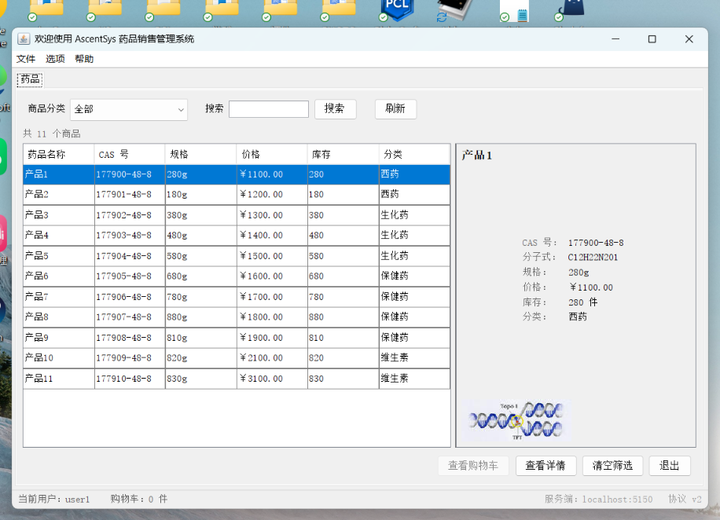

# 前端 v2 交付说明

> 分支：`deliverable/frontend-v2`
> 基线：`main` @ `7b2b35b`（队友 W1 后端已完成的那次提交）
> 作者：前端（成员 A）
> 用途：**评审**客户端 v2 实现。不是可直接合并的成品，合并方案见第五节。

---

## 一、这个分支做了什么

在 `main` 最新提交之上，**只动客户端层**：

| 动作 | 内容 |
|---|---|
| 新增 | `com.ascent.shared`（协议常量、`Result`、错误码、DTO） |
| 新增 | `com.ascent.client`（`Session`、`SocketConnection`、三个控制器） |
| 新增 | `com.ascent.ui` 下的 `AsyncRunner`、`UiTheme`、`Errors` |
| 新增 | `com.ascent.server.mock.MockServer`（联调用模拟服务端） |
| 重写 | `com.ascent.ui` 下 8 个窗口类 |
| 新增 | `docs/client-v2-protocol.md`、`start-*.bat` |
| **未改动** | `com.ascent.common`、`dao`、`db`、`service`、`server`、`pom.xml`、`db/schema.sql`、`test/` |

**main 的结构没有被破坏**：没有删除、没有移动任何队友的文件，新包都是并列新增。

---

## 二、三分钟跑起来

```powershell
cd <仓库根目录>

# 方式一：双击
start-all.bat

# 方式二：两个终端
java -Dfile.encoding=UTF-8 -cp bin com.ascent.server.mock.MockServer
java -Dfile.encoding=UTF-8 -cp bin com.ascent.ui.Ascentsys
```

首次需要编译：

```powershell
javac -encoding UTF-8 --release 11 -d bin (Get-ChildItem -Recurse src -Filter *.java | ForEach-Object FullName)
New-Item -ItemType Directory -Force bin\images | Out-Null
Copy-Item src\images\* bin\images -Force
```

账号：`user1 / 1`，管理员 `admin / admin123`。

期望看到：登录窗口 → 主界面 11 个商品 → 搜索、详情、加购、下单、订单回执。



> ⚠️ 现在客户端连的是 **MockServer**，不是 `main` 里的正式后端。原因见第五节。

---

## 三、改动的文件清单

### 新增（22 个）

```
src/com/ascent/shared/           Protocol, Result, ErrorCode, ApiException
src/com/ascent/shared/dto/       UserDto, LoginResult, ProductDto,
                                 CartItemDto, OrderDto, OrderLineDto
src/com/ascent/client/           Session, SocketConnection,
                                 AuthController, ProductController,
                                 OrderController, AdminProductController,
                                 SocketAuthController, SocketProductController,
                                 SocketOrderController
src/com/ascent/ui/               AsyncRunner, UiTheme, Errors
src/com/ascent/server/mock/      MockServer
```

### 重写（8 个）

`Ascentsys`、`LoginFrame`、`RegistFrame`、`MainFrame`、`ProductPanel`、
`ProductDetailsDialog`、`ShoppingCartDialog`、`ShoppingMessageDialog`

### 未改动

`bean/`、`common/`、`dao/`、`db/`、`service/`、`server/`（除新增 mock 子包）、
`util/`、`test/`、`pom.xml`、`db/schema.sql`、`README.md`

---

## 四、客户端结构

```
Swing 窗口（ui）
   ↓ 只认接口，不认 socket
控制器接口（client.AuthController / ProductController / OrderController）
   ↓ 实现
SocketAuthController 等 → SocketConnection（一个连接，同步请求-响应）
   ↓
服务端（当前是 MockServer，正式后端待对接）
```

几条硬约定：

- **窗口里不允许出现 `new Socket(...)` 或直接发操作码**，全部走控制器；
- 控制器方法**都是阻塞的**，调用方必须放进 `AsyncRunner`（`SwingWorker`），保证 EDT 不被卡住；
- 购物车、当前用户、token 都放在 `Session` 里，由 `MainFrame` 持有并向子窗口传递；
- 业务失败（`Result.fail`）抛 `ApiException`，**不断连接**；IO 失败才断开，下次调用自动重连。

---

## 五、和 main 后端的关系（合并前必读）

现在仓库里有**两套协议定义**，这是本次交付最需要评审讨论的点：

| 本分支（客户端 v2） | main（服务端 W1） |
|---|---|
| `com.ascent.shared.Result<T>` | `com.ascent.common.protocol.Response` |
| `com.ascent.shared.Protocol`（opCode） | `com.ascent.common.OpCode` |
| `com.ascent.shared.ErrorCode` | `com.ascent.common.ErrorCode` |
| `com.ascent.shared.dto.ProductDto` | `com.ascent.common.dto.ProductDTO` |
| `MockServer` | `com.ascent.server.ServerMain` |

**为什么没有直接对接**：两套是并行设计的，强行合并会同时改客户端和服务端，风险大；
所以这个分支先保证客户端自身完整、可运行、可评审。

**建议的合并路径**（三步，工作量约 2h）：

1. **契约二选一**。建议保留 main 的 `common`（服务端、DAO、测试都依赖它），
   把 `shared` 里的 `Result`、`LoginResult` 等**删掉或降级为别名**；
2. **适配层**。`SocketConnection` 改成读写 `common.protocol.Request/Response`，
   控制器内部把 `Response` 转成客户端用的对象。控制器接口签名不变，UI 不用动；
3. **删 MockServer**，改用 `ServerMain`，跑一次端到端。

这样客户端的分层和 UI 全部保留，只换掉最底下一层。

---

## 六、评审重点（建议按顺序看）

| 文件 | 看什么 |
|---|---|
| `client/SocketConnection.java` | 连接复用、超时、断线重连、业务失败不误断连接 |
| `client/Session.java` | 购物车与当前用户绑定，避免 main 旧实现里 `static` 共享的问题 |
| `ui/ProductPanel.java` | 异步加载、服务端搜索、表格与预览联动、按钮状态 |
| `ui/ShoppingCartDialog.java` | 提交成功清空 / 失败保留、数量编辑、总价实时计算 |
| `docs/client-v2-protocol.md` | 协议 v2 的完整定义，含「序列化陷阱」一节 |

### 一个必须知道的坑

`ObjectOutputStream` 会缓存对象句柄：同一个 DTO 第二次发送时只写引用，对端拿到的是**第一次的旧对象**。
症状：扣了库存，界面刷新后数字不变。修法是每次写完调用 `out.reset()`。
本分支的 `SocketConnection` 和 `MockServer` 都已处理，**正式服务端也必须处理**。

---

## 七、已验证

| 项目 | 结果 |
|---|---|
| 全量编译（63 个文件，与 main 代码共存） | 0 错误 |
| 启动 MockServer 读真实数据 | 11 个商品、4 个分类 |
| 登录 + 商品查询 | 通过 |
| 21 项端到端冒烟（登录/搜索/下单/扣库存/权限） | 全通过（详见 wip 分支） |
| 数据文件编码 | `product.db` 现为 UTF-16LE，MockServer 已自适应 GBK/UTF-8/UTF-16 |

---

## 八、未完成

- [ ] 对接 main 的正式后端（见第五节）
- [ ] 订单历史页面（P1）
- [ ] 管理端商品 CRUD（P1）
- [ ] 断线后自动重试登录（当前只提示）
- [ ] 与 `pom.xml` 的集成（本分支未改 pom，加 Maven 后需要把新包纳入编译）

---

## 九、相关分支

| 分支 | 说明 |
|---|---|
| `main` | 队友的 W1 后端，稳定基线 |
| `deliverable/frontend-v2` | **本分支**，客户端 v2 评审用 |
| `wip/client-v2-full` | 基于最初提交的完整可运行版，含旧服务端改造、数据迁移脚本、更多文档；作为开发过程留档，不用于合并 |

---

## 十、想撤销这个分支

```powershell
git branch -D deliverable/frontend-v2          # 删本地
git push origin --delete deliverable/frontend-v2   # 删远端（如果已推送）
```

`main` 不受任何影响。
